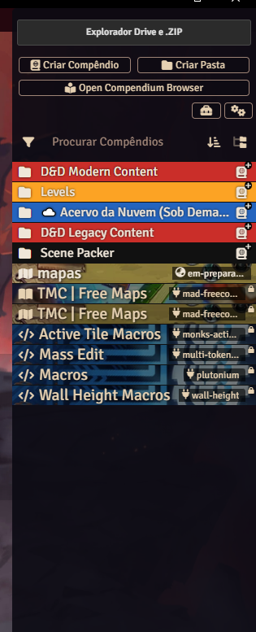
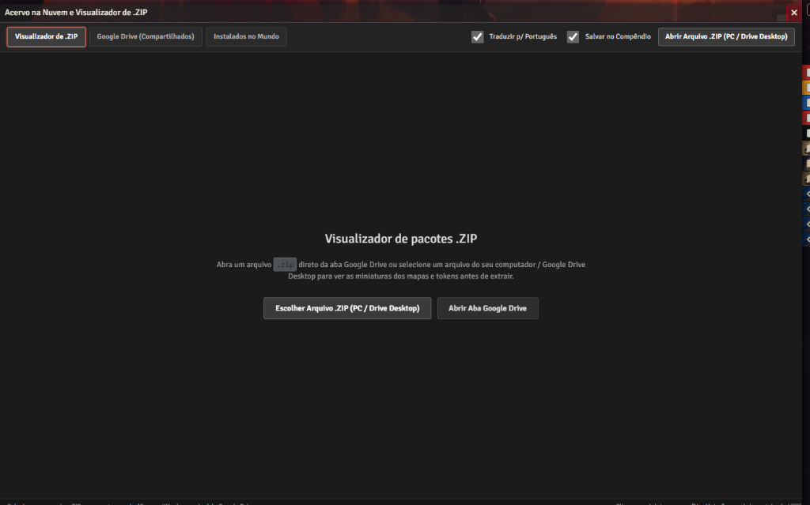
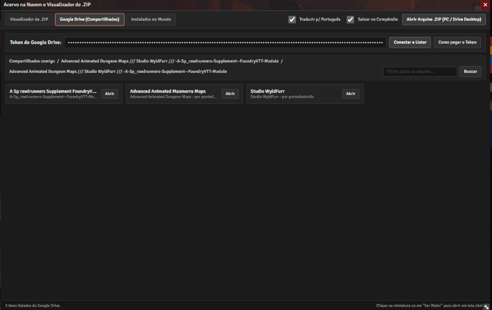
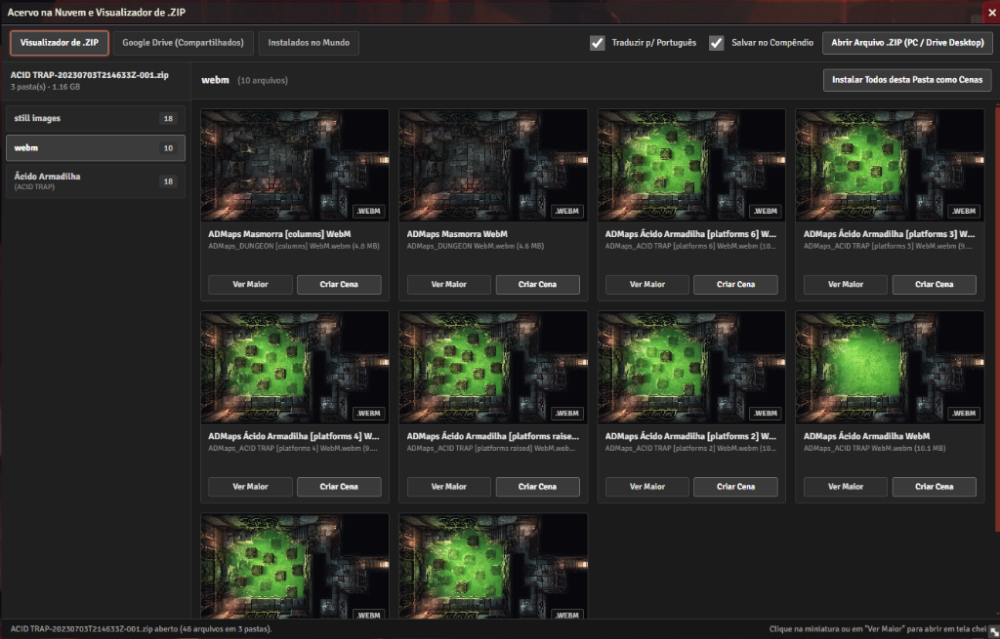
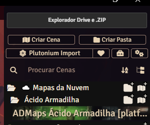

# Acervo na Nuvem e Explorador de ZIP (Foundry VTT)

Módulo para Foundry VTT (v11, v12 e v13+) pensado para grupos que dividem pacotes de mapas (`.webm`, `.mp4`, `.jpg`, `.webp`) e tokens (`.png`, `.webp`) guardados em arquivos `.zip` no Google Drive ou no computador.

## O que o módulo faz

Quando abrimos um arquivo `.zip` direto pelo navegador no Google Drive, não é possível visualizar as imagens dos tokens nem os vídeos dos mapas sem baixar e descompactar o pacote inteiro no PC.

Com este módulo você consegue:

- **Ver as imagens e vídeos de dentro do `.zip` antes de baixar ou extrair:** O módulo lê apenas o índice final do arquivo `.zip` na memória RAM e exibe as miniaturas reais em grade e em tela cheia sem ocupar espaço no HD.
- **Traduzir os nomes automaticamente para Português:** Traduz pastas, criaturas, classes e variações de mapas (`Night -> [Noite]`, `Day -> [Dia]`, `Gridless -> Sem Grade`, etc.).
- **Criar Cenas configuradas com 1 clique:** Extrai apenas o mapa escolhido, detecta a resolução exata da imagem/vídeo, configura o Grid (`100px` / `1,5m`), visão de token e aplica escuridão noturna (`0.5`) automaticamente nos mapas de noite.
- **Criar Tokens Wildcard com 1 clique:** Extrai as variações de uma pasta de criatura ou NPC e já cria a ficha de Ator configurada com caminho curinga (`/*`), sorteando uma pose diferente sempre que o token é arrastado para o mapa.
- **Conectar sua aba "Compartilhados comigo" do Google Drive:** Cada pessoa pode usar seu token de leitura do Google Drive (ou abrir qualquer `.zip` pelo Google Drive Desktop / PC) para ver apenas os pacotes que foram compartilhados com sua conta.

---

## Como instalar no Foundry VTT

1. Na tela inicial do Foundry VTT, acesse a aba **Add-on Modules (Módulos)** e clique em **Install Module (Instalar Módulo)**.
2. No campo **Manifest URL** (lá embaixo na janela), cole o link abaixo e clique em **Install**:

```text
https://raw.githubusercontent.com/featsamy/acervo-nuvem-drive/main/module.json
```

3. Abra o seu mundo, vá em **Configurações -> Gerenciar Módulos** e ative **Acervo na Nuvem e Explorador de ZIP (Google Drive)**.
4. Clique no botão **Explorador Drive e .ZIP** no topo da aba de **Cenas**, **Atores** ou **Compêndios**.

---

## Prints do módulo funcionando

### 1. Acesso pela aba de Compêndios, Cenas ou Atores


### 2. Tela inicial do Explorador


### 3. Navegando pelas pastas da aba "Compartilhados comigo" do Google Drive


### 4. Visualizando miniaturas de dentro do arquivo .ZIP antes de extrair


### 5. Cena criada e organizada automaticamente em pastas traduzidas

